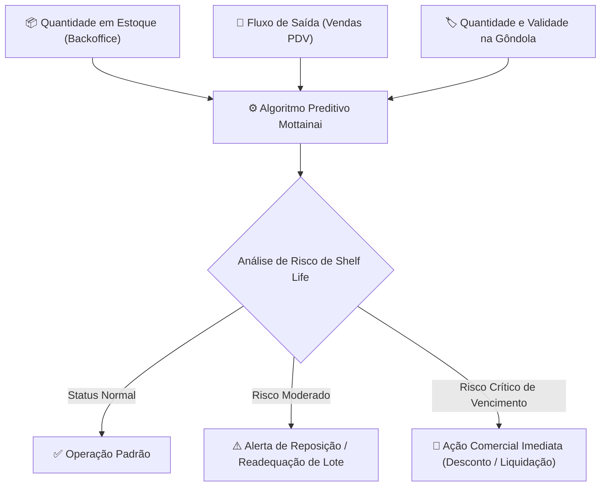

<div align="center">

# 📦 Mottainai 📦

### *Gestão preditiva de estoque e combate ao desperdício no varejo alimentício*

[](https://www.oracle.com/java/)
[](https://spring.io/projects/spring-boot)
[](https://www.postgresql.org/)
[](#-segurança-privacidade-e-conformidade-lgpd)
[](LICENSE)

<br/>

> **"Mottainai" (もったいない):** Filosofia japonesa que expressa o pesar pelo desperdício daquilo que possui valor intrínseco. Nosso objetivo é transformar perdas operacionais em eficiência e sustentabilidade no varejo de alimentos perecíveis.

</div>

---

## 📌 Sumário
- [Visão Geral e Proposta](#-visão-geral-e-proposta)
- [Público-Alvo e Atores](#-público-alvo-e-atores)
- [Arquitetura do Algoritmo Preditivo](#-arquitetura-do-algoritmo-preditivo)
- [Segurança, Privacidade e Conformidade LGPD](#-segurança-privacidade-e-conformidade-lgpd)
- [Estrutura do Repositório](#-estrutura-do-repositório)
- [Tecnologias Utilizadas](#-tecnologias-utilizadas)
- [Guia de Execução Local](#-guia-de-execução-local)
- [Equipe de Desenvolvimento](#-equipe-de-desenvolvimento)
- [Licença](#-licença)

---

## 💡 Visão Geral e Proposta

O projeto **Mottainai** é uma plataforma corporativa desenvolvida por alunos do **Instituto J&F** com foco na gestão preditiva de estoque e shelf life para alimentos perecíveis.

No setor varejista, a falta de sincronia entre o estoque físico e a velocidade de saída nas gôndolas acarreta rupturas operacionais e quebras financeiras massivas devido ao vencimento de produtos. O Mottainai monitora proativamente cada lote e sugere intervenções comerciais imediatas (como descontos progressivos e redistribuição) antes que o item chegue ao descarte.

### Objetivos-Chave
- 📉 **Redução de perdas e quebras:** Antecipação de datas críticas de vencimento.
- 📦 **Otimização de gôndola:** Reposição inteligente baseada na cadência real de vendas.
- 🔔 **Alertas inteligentes:** Avisos prioritários para tomada de ação operacional e gerencial.
- 🛡️ **Segurança por Padrão (Security & Privacy by Design):** Salvaguarda de dados corporativos e pessoais com criptografia forte e anonimização em múltiplas camadas.

---

## 👥 Público-Alvo e Atores

A plataforma foi desenhada sob medida para:

| Segmento | Perfis de Usuário | Casos de Uso Típicos |
| :--- | :--- | :--- |
| **Pequeno e Médio Varejo** <br>*(Supermercados, Lojas de Conveniência, Hortifrútis, Cash & Carry)* | **Gestores & Gerentes de Loja** | Visualização de relatórios analíticos, tomada de decisões sobre precificação dinâmica e reabastecimento. |
| **Operação de Loja** | **Colaboradores e Repositores** | Consulta de inventário de gôndola, recebimento de alertas operacionais e validação de lotes. |

---

## 🧠 Arquitetura do Algoritmo Preditivo

O motor do sistema cruza em tempo real três variáveis críticas para cada **SKU** (*Stock Keeping Unit*):



---

## 🛡️ Segurança, Privacidade e Conformidade LGPD

O projeto adota uma arquitetura em conformidade com as boas práticas da **LGPD (Lei Geral de Proteção de Dados)**. Dados sensíveis e dados pessoais identificáveis (PII) passam por mecanismos rigorosos de proteção:

```
[ Cliente / Interface ]
       │
       ▼ (Camada de Apresentação)
┌────────────────────────────────────────────────────────┐
│  • Mascaramento parcial (E-mails e Telefones)          │
│  • Pseudonimização por substituição (Relatórios/Logs)  │
└────────────────────────────────────────────────────────┘
       │
       ▼ (Camada de Negócio / Back-end)
┌────────────────────────────────────────────────────────┐
│  • Criptografia em Trânsito (TLS)                      │
│  • Tokenização de Documentos (CPF / CNPJ)              │
│  • Validação estrutural rigorosa (CpfValidator)        │
└────────────────────────────────────────────────────────┘
       │
       ▼ (Camada de Persistência / Banco de Dados)
┌────────────────────────────────────────────────────────┐
│  • Criptografia em Repouso: AES-256-GCM               │
│  • Hashing Adaptativo: BCrypt / Argon2id (Senhas)      │
│  • Segregação de cofres de tokens                      │
└────────────────────────────────────────────────────────┘
```

### Matriz de Tratamento de Dados

| Entidade | Atributos | Técnica de Proteção | Justificativa Técnica & Negócio |
| :--- | :--- | :--- | :--- |
| **`Company` / `Store`** | `email`, `phone` | **Mascaramento Parcial** | Exibição segura em relatórios e telas (ex: `m***@empresa.com`, `(11) 9****-8888`), prevenindo exposição acidental sem inviabilizar o reconhecimento do canal de contato. |
| **`Employee`** | `name`, `email`, `phone` | **Pseudonimização por Substituição** | Substituição de identidades por IDs artificiais (`EMP_001`, `EMAIL_EMP_001`) em logs, testes e fluxos analíticos internos. |
| **`Employee`** | `cpf` | **Tokenização + AES-256-GCM** | O CPF original é substituído por token opaco (`CPF_TKN_8F4A91`) e guardado em repositório seguro com chave criptográfica, impedindo vazamento de dado cadastral único. |
| **`UserAccount`** | `email` | **Pseudonimização por Substituição** | Proteção da credencial de conta em traces e logs de auditoria; versão original isolada exclusivamente para autenticação. |
| **`UserAccount`** | `passwordHash` | **Hash Adaptativo (BCrypt / Argon2id)** | Mecanismo unidirecional irreversível com salt embutido contra ataques de dicionário e *rainbow tables*. |

> **Nota:** Todos os dados sensíveis em repouso no banco de dados contam com cifra simétrica padrão da indústria via **AES-256 no modo GCM** (*Galois/Counter Mode*), garantindo integridade e confidencialidade autenticada.

---

## 📂 Estrutura do Repositório

O projeto é estruturado no formato Monorepo para facilitar a rastreabilidade entre regras de negócio, dados e telas:

```text
Mottainai-Primeiro-Ano/
├── back-end/
│   └── mottainai-crud/              # Serviço Spring Boot com arquitetura modular em camadas
│       ├── src/main/java/com/mottainai/mottainaicrud/
│       │   ├── config/              # Configurações de segurança, CORS e instâncias
│       │   ├── controller/          # Endpoints REST expostos
│       │   ├── dao/                 # Repositórios de persistência de dados (JPA/JDBC)
│       │   ├── dto/                 # Data Transfer Objects (transferência segura de dados)
│       │   ├── exception/           # Handlers globais de exceções de negócio
│       │   ├── model/               # Entidades de domínio
│       │   ├── service/             # Regras de negócio e orquestração do algoritmo
│       │   ├── util/                # Utilitários criptográficos e auxiliares
│       │   └── validation/          # Validadores customizados (ex: ValidCPF)
│       └── build.gradle             # Configurações de dependências e build do Gradle
├── front-end/                       # Interface do usuário em HTML5, CSS3 e JavaScript Vanilla
│   └── landing/                     # Página inicial e estrutura do site
│       ├── assets/                  # Recursos estáticos da aplicação
│       │   ├── css/                 # Folhas de estilo e estilização da interface
│       │   ├── icons/               # Ícones vetoriais (SVG) e favicons
│       │   ├── images/              # Imagens, logotipos e ilustrações do projeto
│       │   └── js/                  # Scripts JavaScript (interações e chamadas à API)
│       └── pages/                   # Páginas secundárias do site (planos, sobre-nos, etc.)
│           ├── planos.html          # Apresentação dos planos comerciais e adesão
│           └── sobre-nos.html       # Apresentação do propósito, time e missão
└── dados/                           # Modelagem de banco de dados, scripts DDL e rotinas de anonimização
```

---

## 🛠️ Tecnologias Utilizadas

### Back-end
- **Linguagem:** Java 21 (LTS)
- **Framework:** Spring Boot 4.0.0
- **Persistência:** Spring Data JPA, Spring JDBC & PostgreSQL Driver
- **Validação:** Bean Validation (`jakarta.validation`)
- **Produtividade:** Project Lombok
- **Gerenciador de Dependências:** Gradle Wrapper

### Front-end & Design
- **Core:** HTML5 semântico, CSS3 e JavaScript puro (Vanilla JS)
- **UI/UX Design & Prototipagem:** Figma

### Banco de Dados & Segurança
- **SGBD:** PostgreSQL
- **Criptografia Simétrica:** AES-256-GCM
- **Algoritmo de Hash:** BCrypt / Argon2id

---

## Guia de Execução Local

### Pré-requisitos
- **Java Development Kit (JDK):** Versão 21 instalada e configurada no `PATH`.
- **PostgreSQL:** Instância rodando localmente ou via container Docker na porta `5432`.
- **Git**

### 1. Clonar o Repositório
```bash
git clone https://github.com/Mottainai-One/Mottainai-Primeiro-Ano.git
cd Mottainai-Primeiro-Ano
```

### 2. Configurar o Banco de Dados
Crie a base de dados no PostgreSQL:
```sql
CREATE DATABASE mottainai_db;
```

Configure as credenciais em `back-end/mottainai-crud/src/main/resources/application.properties` (ou através de variáveis de ambiente).

### 3. Executar o Back-end
```bash
cd back-end/mottainai-crud

# No Linux/macOS:
./gradlew bootRun

# No Windows:
.\gradlew.bat bootRun
```
A API iniciará por padrão em `http://localhost:8080`.

### 4. Executar o Front-end
Como o front-end é construído com tecnologias web nativas (HTML5/CSS3/JS), basta abrir o arquivo principal da landing page:
```bash
# Abrir diretamente no navegador padrão:
# No Windows:
start front-end/landing/index.html

# No Linux:
xdg-open front-end/landing/index.html

# No macOS:
open front-end/landing/index.html
```
Alternativamente, sirva os arquivos através de um servidor estático local ou extensões como *Live Server* no VS Code / IntelliJ IDEA.

---

## 🎓 Equipe de Desenvolvimento

Projeto concebido e implementado pelos estudantes do **Primeiro Ano do Instituto J&F**:

* 👨‍💻 **Gustavo Cardoso**
* 👨‍💻 **João Victor**
* 👩‍💻 **Giovanna Sartori**
* 👩‍💻 **Luana Pedroso**
* 👨‍💻 **Miguel Quadros**
* 👨‍💻 **Pedro Angelo**

---

## 📄 Licença

Este projeto está sob os termos da licença [MIT](LICENSE). Consulte o arquivo de licença para maiores detalhes.