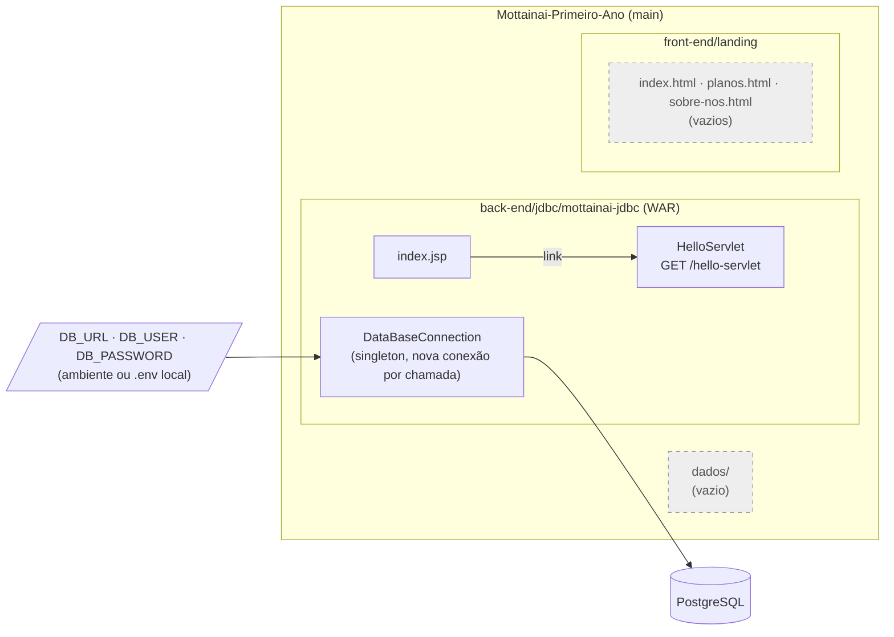
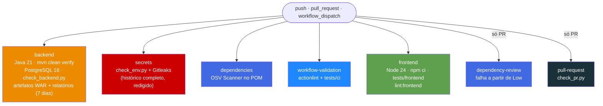

<div align="center">

# Mottainai · Primeiro Ano

**Repositório interdisciplinar do primeiro ano do Mottainai: gestão preditiva de estoque para pequenos e médios varejos**

*Esqueleto do backend Java (Servlet + JDBC + PostgreSQL), estrutura da landing page estática e um pipeline de CI com sete jobs de qualidade e segurança.*

<br/>

[](back-end/jdbc/mottainai-jdbc/pom.xml)
[](back-end/jdbc/mottainai-jdbc/pom.xml)
[](back-end/jdbc/mottainai-jdbc/pom.xml)
[](back-end/jdbc/mottainai-jdbc/pom.xml)

[](.github/workflows/ci.yml)
[](back-end/jdbc/mottainai-jdbc/pom.xml)
[](scripts/ci)
[-5FA04E?style=flat-square&logo=nodedotjs&logoColor=white)](package.json)
[](LICENSE)
[](#2-status-do-projeto)

<br/>

[Visão geral](#1-visão-geral) •
[Status](#2-status-do-projeto) •
[Arquitetura](#3-arquitetura) •
[Tecnologias](#4-tecnologias) •
[Estrutura](#5-estrutura-do-repositório) •
[Backend](#6-backend-java--jdbc) •
[Frontend](#7-frontend-landing-page) •
[Configuração](#8-configuração-e-variáveis-de-ambiente) •
[Execução](#9-como-executar-localmente) •
[CI](#10-testes-e-integração-contínua) •
[Branches](#11-branches-e-fluxo-de-contribuição) •
[Riscos](#12-segurança-limitações-e-roadmap)

</div>

---

## 1. Visão geral

O **Mottainai** (もったいない, expressão japonesa para *"que desperdício"*) é um sistema de gestão preditiva de estoque para pequenos e médios varejos, desenvolvido como projeto acadêmico multi-repositório na organização [Mottainai-One](https://github.com/Mottainai-One).

Este repositório concentra as **entregas do primeiro ano** do curso. Na branch `main`, o conteúdo é uma **fundação técnica**, não um produto funcional:

| | Bloco | O que existe hoje na `main` |
|---|---|---|
| **1** | **Backend** | Projeto Maven `mottainai-jdbc` (WAR) com um `HelloServlet` de exemplo, `index.jsp` e uma fábrica de conexões JDBC para PostgreSQL. Nenhuma regra de negócio, entidade ou endpoint de estoque. |
| **2** | **Frontend** | Estrutura de pastas da landing (`index.html`, `planos.html`, `sobre-nos.html`, `style.css`). **Todos os arquivos estão vazios (0 bytes).** |
| **3** | **Dados** | Apenas a pasta `dados/` com `.gitkeep`. Nenhum dataset, script SQL ou modelo de dados na `main`. |
| **4** | **CI** | Workflow com 7 jobs (build/testes Java, segredos, dependências, revisão de dependências, workflows, landing e metadados de PR) e validadores Python com testes próprios. |

> [!NOTE]
> A API do GitHub classifica a linguagem principal como **Python**, mas o Python aqui é **apenas ferramental de CI** (`scripts/ci/` e `tests/`). O código de aplicação é **Java**. O tamanho reportado do repositório (~19 MB) vem das **outras branches** (principalmente imagens da landing em `front-end`); a `main` tem 45 arquivos versionados e um pack Git de ~100 KB no clone analisado.

---

## 2. Status do projeto

| Item | Branch `main` | Observação |
|---|:---:|---|
| Estrutura de pastas (`back-end/`, `front-end/`, `dados/`) |  | |
| Conexão JDBC com PostgreSQL via variáveis de ambiente |  | Testada no CI contra PostgreSQL 16 temporário |
| Servlet/JSP de exemplo ("Hello World") |  | Código de template, sem função de negócio |
| Pipeline de CI com 7 jobs |  | Adicionado no commit `89e70f1` |
| Landing page com conteúdo |  | Vazia na `main`; conteúdo existe na branch `front-end` |
| CRUD / modelos / DAOs |  | Em branches separadas (Spring Boot + Gradle), não integradas |
| Modelo de dados / script SQL |  | `script.sql` existe só na branch `back-end` |
| Deploy em servidor Servlet |  | Não há deploy nem teste HTTP do WAR (ver `docs/CI.md`) |

> [!WARNING]
> Nada na `main` implementa a gestão preditiva de estoque em si. Previsão, alertas, chatbot e BI vivem em outros repositórios da organização ou ainda não foram implementados.

---

## 3. Arquitetura

### Visão da branch `main`



> [!NOTE]
> O `HelloServlet` **não usa** o `DataBaseConnection`. Hoje a conexão é exercitada somente pelos testes JUnit (`SELECT 1`). Não há camada de serviço, DAO ou modelo na `main`.

### Arquitetura em evolução (outras branches, inferência)

Pelas branches remotas, o time está migrando o backend para **Spring Boot + Gradle** em `back-end/mottainai-crud/`, com pacotes `controller`, `dao`, `dto`, `model`, `service`, `validation` etc. O `docs/CI.md` confirma que "o projeto Gradle da branch `back-end` é separado e não é migrado" pelo CI atual. Ver [seção 11](#11-branches-e-fluxo-de-contribuição).

---

## 4. Tecnologias

Somente versões **observadas em arquivos** da `main`.

<table>
<tr>
<td align="center" width="140"><br/><b>Java 21</b><br/><sub><code>maven.compiler.release</code><br/>Temurin no CI</sub></td>
<td align="center" width="140"><br/><b>Jakarta Servlet 6.1.0</b><br/><sub>+ JAX-RS API 4.0.0<br/>(<code>provided</code>)</sub></td>
<td align="center" width="140"><br/><b>PostgreSQL</b><br/><sub>Driver 42.7.13<br/>Serviço 16 no CI</sub></td>
<td align="center" width="140"><br/><b>Maven 3.9.6</b><br/><sub>via Maven Wrapper 3.3.0<br/>empacotamento WAR</sub></td>
</tr>
<tr>
<td align="center" width="140"><br/><b>JUnit 5.13.2</b><br/><sub>Surefire 3.5.3<br/>JaCoCo 0.8.13</sub></td>
<td align="center" width="140"><br/><b>Python 3</b><br/><sub>Validadores de CI<br/>(stdlib + <code>unittest</code>)</sub></td>
<td align="center" width="140"><br/><b>Node.js 24</b><br/><sub>HTMLHint 1.9.2<br/>Stylelint 17.16.0</sub></td>
<td align="center" width="140"><br/><b>GitHub Actions</b><br/><sub>7 jobs, actions<br/>fixadas por SHA</sub></td>
</tr>
</table>

### Bibliotecas e ferramentas

| Componente | Versão | Onde | Uso |
|---|---|---|---|
| `jakarta.servlet-api` | 6.1.0 (`provided`) | `pom.xml` | Servlet `HelloServlet` |
| `jakarta.ws.rs-api` | 4.0.0 (`provided`) | `pom.xml` | Declarada, **sem uso no código** atual |
| `org.postgresql:postgresql` | 42.7.13 | `pom.xml` | Driver JDBC |
| `io.github.cdimascio:dotenv-java` | 3.2.0 | `pom.xml` | Leitura opcional de `.env` local |
| `maven-checkstyle-plugin` | 3.6.0 | `pom.xml` + `checkstyle.xml` | Estilo (fase `validate`) |
| `spotbugs-maven-plugin` | 4.9.8.2 | `pom.xml` | Defeitos, esforço `Max`, limiar `Low` |
| `maven-war-plugin` / `maven-compiler-plugin` | 3.4.0 / 3.14.0 | `pom.xml` | Empacotamento e compilação |
| Gitleaks | v8.24.2 (imagem com digest) | `ci.yml` | Varredura de segredos no histórico |
| OSV Scanner | v2.7.0 (checksum verificado) | `ci.yml` | Vulnerabilidades do POM |
| actionlint | 1.7.7 (checksum verificado) | `ci.yml` | Lint dos workflows |

---

## 5. Estrutura do repositório

```text
Mottainai-Primeiro-Ano/   (branch main, 45 arquivos)
├── .github/
│   ├── pull_request_template.md       # Template de PR (Description, Changes Made, Validation)
│   └── workflows/ci.yml               # 7 jobs de CI
├── back-end/
│   └── jdbc/mottainai-jdbc/           # Projeto Maven (WAR)
│       ├── .idea/                     # Config do IntelliJ versionada
│       ├── .mvn/wrapper/              # Maven Wrapper (jar binário ~58 KB)
│       ├── checkstyle.xml
│       ├── mvnw · mvnw.cmd
│       ├── pom.xml
│       └── src/
│           ├── main/java/org/mot/mottainaijdbc/
│           │   ├── HelloServlet.java
│           │   └── connection/DataBaseConnection.java
│           ├── main/webapp/ (index.jsp, WEB-INF/web.xml)
│           └── test/java/org/mot/mottainaijdbc/ (HelloServletTest, DataBaseConnectionTest)
├── dados/                             # Vazio (.gitkeep)
├── docs/CI.md                         # Documentação do pipeline
├── front-end/landing/                 # Estrutura da landing; HTML/CSS com 0 bytes
│   ├── index.html · pages/planos.html · pages/sobre-nos.html
│   └── assets/{css/style.css, icons/, images/, js/}
├── scripts/ci/                        # Validadores Python usados pelo CI
│   ├── check_backend.py · check_env.py · check_frontend.py · check_pr.py
├── tests/
│   ├── ci/                            # Testes dos validadores (unittest)
│   └── frontend/                      # Testes do check_frontend com fixtures
├── package.json · package-lock.json   # Ferramentas de lint da landing (devDependencies)
├── .htmlhintrc · .stylelintrc.json
├── LICENSE (MIT) · README.md
```

---

## 6. Backend (Java + JDBC)

### `DataBaseConnection`

Classe `final` em `org.mot.mottainaijdbc.connection`:

- **Singleton** (`getInstance()` sincronizado) que lê `DB_URL`, `DB_USER` e `DB_PASSWORD` uma única vez.
- Usa `dotenv-java` com `ignoreIfMissing()`: variáveis de ambiente têm precedência; `.env` local é opcional.
- Falha com `IllegalStateException("Configuração obrigatória ausente: <NOME>")` sem imprimir valores.
- `connection()` retorna **uma conexão nova a cada chamada** (`DriverManager.getConnection`); o chamador deve fechá-la com *try-with-resources*. Isso corrigiu um alerta do SpotBugs sobre estado mutável compartilhado (segundo `docs/CI.md`).

> [!IMPORTANT]
> Não há **pool de conexões**. Cada chamada abre uma conexão TCP nova com o PostgreSQL. Serve para o escopo acadêmico atual, mas não escala sob carga concorrente (ver [seção 12](#12-segurança-limitações-e-roadmap)).

### `HelloServlet` e `index.jsp`

| Recurso | Rota | Comportamento |
|---|---|---|
| `index.jsp` | `/` | Página "Hello World" com link para o servlet |
| `HelloServlet` | `GET /hello-servlet` | Retorna HTML fixo `<h1>Hello World!</h1>` |

`web.xml` declara Jakarta EE `web-app` 6.0 sem mapeamentos (o servlet usa `@WebServlet`). Ambos são código de template de IDE, sem relação com o domínio de estoque.

### Build

| Fase Maven | O que roda |
|---|---|
| `validate` | Checkstyle (`failOnViolation=true`, inclui testes) |
| `test` | Surefire com `failIfNoTests=true` e `testFailureIgnore=false` |
| `verify` | Relatório JaCoCo + SpotBugs (`check`) |
| `package` | WAR `mottainai-jdbc-1.0-SNAPSHOT` (nome inferido de `artifactId`/`version`) |

---

## 7. Frontend (landing page)

Na `main`, a landing é **somente estrutura**: `index.html`, `pages/planos.html`, `pages/sobre-nos.html` e `assets/css/style.css` existem com **0 bytes**; `assets/icons`, `assets/images` e `assets/js` têm apenas `.gitkeep`.

O validador `scripts/ci/check_frontend.py` trata isso explicitamente: se não houver HTML/CSS/JS com conteúdo, apenas registra *"Landing contains only placeholders"* no resumo do job e **não falha**. Assim que houver conteúdo, ele passa a rodar:

- HTMLHint (regras em `.htmlhintrc`: `doctype-first`, `title-require`, `id-unique`, `tag-pair` etc.);
- Stylelint (regras em `.stylelintrc.json`: `color-no-invalid-hex`, `property-no-unknown` etc.);
- `node --check` para JavaScript;
- checagem de referências locais (`src`, `href`, `poster`, `srcset`, `url()`, `@import`): falha se o alvo não existir, sair da raiz da landing ou apontar para arquivo vazio. URLs externas não são acessadas.

> [!NOTE]
> O conteúdo visual da landing (páginas, `about-us.css`, ícones e imagens, ~13 MB) está na branch **`front-end`** (último commit `1daad10`, 2026-10-27), ainda não mesclado na `main`.

---

## 8. Configuração e variáveis de ambiente

| Variável | Obrigatória | Lida por | Descrição |
|---|:---:|---|---|
| `DB_URL` | sim | `DataBaseConnection` | URL JDBC do PostgreSQL (`jdbc:postgresql://...`) |
| `DB_USER` | sim | `DataBaseConnection` | Usuário do banco |
| `DB_PASSWORD` | sim | `DataBaseConnection` | Senha do banco |
| `GITHUB_EVENT_PATH` | só CI | `check_pr.py` | Payload do evento de PR (fornecido pelo Actions) |
| `GITHUB_STEP_SUMMARY` | só CI | `check_frontend.py` | Resumo do job (opcional) |

> [!CAUTION]
> Nunca versione `.env`. O `.gitignore` raiz ignora `.env`, `.env.*` e `*.env`, permitindo apenas `.env.example`, `.env.sample` e `.env.template`, e o job `secrets` falha se algum arquivo de ambiente proibido estiver no índice. O CI usa um PostgreSQL descartável com credenciais **exclusivas de teste**, definidas em `ci.yml` e `docs/CI.md`; não as reutilize em nenhum outro ambiente.

Não existe `.env.example` na `main` (não confirmado se planejado).

---

## 9. Como executar localmente

### Pré-requisitos

- [ ] JDK 21
- [ ] Maven (o CI usa `mvn` do runner; o wrapper aponta para Maven 3.9.6)
- [ ] PostgreSQL acessível (o CI usa a imagem `postgres:16`) — **banco descartável, nunca produção**
- [ ] Python 3 (validadores) e Node.js 24 + npm (lint da landing)

### Backend: build e testes

Comandos documentados em `docs/CI.md`, a partir da raiz do repositório:

```bash
# 1. Suba um PostgreSQL descartável (ver docs/CI.md para o comando docker completo)
# 2. Exporte DB_URL, DB_USER e DB_PASSWORD apontando para ele
# 3. Build, testes, Checkstyle, SpotBugs e JaCoCo
mvn -B -ntp -f back-end/jdbc/mottainai-jdbc/pom.xml clean verify

# 4. Confere WAR não vazio, testes executados e relatório JaCoCo
python scripts/ci/check_backend.py
```

> [!WARNING]
> Os testes de `DataBaseConnectionTest` **exigem** um PostgreSQL real e as três variáveis definidas; sem elas o `mvn verify` falha. O `mvnw` está versionado **sem permissão de execução** (modo `100644`); para usar o wrapper em Linux/macOS seria preciso `chmod +x`, ou use o `mvn` instalado como o CI faz.

Não há instrução no repositório para **implantar o WAR** em um contêiner Servlet (Tomcat, Jetty etc.); qual servidor o time usa não está confirmado no repositório.

### Frontend: lint

```bash
npm ci --ignore-scripts
npm run lint:frontend
```

### Validadores Python

```bash
python3 -m unittest discover -s tests/ci -v
python3 -m unittest discover -s tests/frontend -v   # requer node_modules (npm ci)
```

---

## 10. Testes e integração contínua

### Testes

| Suíte | Arquivo | O que cobre |
|---|---|---|
| JUnit | `HelloServletTest` | Content-Type `text/html` e HTML retornado (response via `Proxy`) |
| JUnit | `DataBaseConnectionTest` | Singleton, conexão PostgreSQL válida, `SELECT 1`, conexões independentes |
| unittest | `tests/ci/test_validators.py` | Título Conventional Commits e seções obrigatórias da PR |
| unittest | `tests/ci/test_check_env.py` | Bloqueio de arquivos `.env` versionados |
| unittest | `tests/ci/test_backend_reports.py` | Regras do `check_backend.py` |
| unittest | `tests/frontend/test_frontend.py` | Linters reais sobre fixtures válidas e inválidas |

JaCoCo gera relatório, mas **não impõe cobertura mínima** (decisão registrada em `docs/CI.md`).

### Pipeline (`.github/workflows/ci.yml`)

Dispara em `push` para `main`, `back-end` e `front-end`, em `pull_request` (incluindo `edited`) e manualmente. Permissão do token: `contents: read`; execuções concorrentes da mesma PR/ref são canceladas.



<details>
<summary><b>Regras do validador de PR (<code>check_pr.py</code>)</b></summary>

<br/>

1. Título no formato Conventional Commits: `feat|fix|docs|style|refactor|perf|test|build|ci|chore|revert`, escopo opcional, `!` opcional.
2. Seções `## Description`, `## Changes Made` e `## Validation` com ao menos 20 caracteres de conteúdo real.
3. Comentários HTML, blocos de código, checkboxes e `---` são removidos antes da contagem.
4. Textos de placeholder do template e `TODO`/`TBD` são rejeitados.
5. O payload é lido do arquivo de evento, sem interpolação em shell.

</details>

> [!NOTE]
> Segundo `docs/CI.md`, um administrador **pode** exigir os sete jobs no ruleset da `main` para bloquear merge; se isso foi feito não é verificável pelo clone.

---

## 11. Branches e fluxo de contribuição

### Histórico da `main`

| Commit | Data | Mensagem |
|---|---|---|
| `902e236` | 2026-10-07 | Initial commit |
| `40c5ed6` | 2026-10-09 | feat: Folder structure |
| `246adb8` | 2026-10-16 | feat: adding the database connection using JDBC |
| `4abe4d2` | 2026-10-16 | feat: Creating folder structure for front-end for organization |
| `89e70f1` | 2026-10-26 | ci: add Java backend and frontend quality checks |

Os quatro últimos commits foram registrados pelo autor `mottainai-pr-bot[bot]` (merge automatizado; autoria humana original não confirmada no clone).

### Outras branches (25 no remoto, 2026-10-27)

| Grupo | Branches | Conteúdo observado |
|---|---|---|
| Backend Spring | `back-end`, `feature/setup-spring-back-end`, `chore/crud-package-structure`, `feat/crud-models`, `feat/crud-spring-dao`, `feat/crud-validators`, `feature/crud-view` | Projeto `back-end/mottainai-crud/` com **Gradle + Spring Boot 4.0.0** (plugin), Java 21, starters `data-jpa`, `jdbc`, `validation`, `webmvc`; `script.sql` com 8 `CREATE TABLE` (em `back-end`); DAOs como `CompanyDao`, `StoreDao`, `EmployeeDao`, `UserAccountDao` e `CpfValidator` (em `feat/crud-spring-dao`) |
| Backend JDBC | `feature/jdbc-connection`, `feature/jdbc-model`, `feature/jdbc-dao` | Evolução do módulo JDBC (conteúdo não inspecionado) |
| Frontend | `front-end`, `feature/landing-home-v1/v2`, `feature/landing-about-us-v1/v2`, `feat/adding-about-us-html-and-images`, `chore/front-end-folder-structure`, `feature/front-end-folder-structure` | Landing com HTML/CSS e ~13 MB de imagens (branch `front-end`) |
| Docs / CI / outros | `docs/readme-project`, `docs/readme-standardization`, `ci/backend-quality-checks`, `revert-21-ci/backend-quality-checks`, `feature/folder-structure`, `dados` | `dados` aponta para o mesmo commit `40c5ed6` da `main` (sem conteúdo extra) |

> [!WARNING]
> **Dois backends concorrentes**: Maven/Servlet/JDBC puro na `main` e Gradle/Spring Boot nas branches de CRUD. O CI atual valida **só o Maven**. Embora `ci.yml` liste `back-end` e `front-end` como gatilhos de push, essas branches **ainda não contêm** `.github/workflows/ci.yml` (o Actions usa o workflow da própria branch), então hoje nada roda nelas. Quando a `main` for mesclada em `back-end`, o job `backend` tende a falhar, pois `back-end/jdbc/mottainai-jdbc/pom.xml` não existe lá (inferência, não executado).

### Convenções

- Commits e títulos de PR em **Conventional Commits** (validado no CI).
- PR segue `.github/pull_request_template.md`; a seção **Validation** precisa de evidência concreta (comandos e resultados), checkboxes não bastam.

---

## 12. Segurança, limitações e roadmap

### Riscos e limitações

| # | Item | Impacto | Recomendação |
|---|---|---|---|
| 1 | Backend duplicado (Maven/JDBC vs Gradle/Spring) e CI cobrindo só o Maven | Retrabalho, CI quebrado ao integrar `back-end` | Decidir o backend oficial e adaptar `ci.yml` antes do merge |
| 2 | `DataBaseConnection` sem pool | Esgotamento de conexões sob concorrência | Adotar pool (ex.: HikariCP, padrão no Spring Boot) se o JDBC puro permanecer |
| 3 | Landing vazia na `main`; conteúdo só em branch | `main` não representa o estado real do frontend | Mesclar `front-end` via PR passando pelo job `frontend` |
| 4 | Imagens pessoais na branch `front-end` (ex.: fotos de integrantes) | Exposição de imagem de pessoas (LGPD) e peso do repo | Confirmar consentimento; comprimir imagens; avaliar Git LFS |
| 5 | Branch `feat/crud-spring-dao` contém validação de CPF | Futuro tratamento de dado pessoal | Planejar mascaramento, minimização e base legal antes de persistir CPF |
| 6 | `.idea/` versionado apesar do `.gitignore` raiz; `mvnw` sem bit de execução | Ruído em PRs; wrapper inutilizável em Unix | `git rm --cached` do `.idea/`; `git update-index --chmod=+x mvnw` |
| 7 | `jakarta.ws.rs-api` declarada sem uso | Dependência morta | Remover ou usar |

> [!IMPORTANT]
> As checagens de CI (Gitleaks, OSV, Dependency Review) reduzem risco, mas **não substituem** revisão de segurança, especialmente quando entrarem autenticação, CPF e dados de clientes.

### Roadmap (inferido das branches, não documentado oficialmente)

- [x] Estrutura de pastas e conexão JDBC
- [x] CI de qualidade e segurança
- [ ] Integrar a landing (`front-end`) na `main`
- [ ] Definir backend oficial e integrar CRUD (modelos, DAOs, validadores, views)
- [ ] Versionar o modelo de dados (`script.sql`) na `main` e documentar o schema
- [ ] Definir cobertura mínima no JaCoCo
- [ ] Documentar deploy do WAR

---

<details>
<summary><b>Rastreabilidade desta documentação</b></summary>

<br/>

- **Repositório:** `Mottainai-One/Mottainai-Primeiro-Ano`
- **Branch / commit analisado:** `main` @ `89e70f1`
- **Data da análise:** 2026-10-27
- **Arquivos consultados (main):** `README.md`, `LICENSE`, `.gitignore`, `.htmlhintrc`, `.stylelintrc.json`, `package.json`, `package-lock.json` (cabeçalho), `.github/workflows/ci.yml`, `.github/pull_request_template.md`, `docs/CI.md`, `back-end/jdbc/mottainai-jdbc/{pom.xml, .gitignore, .idea/misc.xml, .mvn/wrapper/maven-wrapper.properties}`, `HelloServlet.java`, `DataBaseConnection.java`, `web.xml`, `index.jsp`, `HelloServletTest.java`, `DataBaseConnectionTest.java`, `scripts/ci/*.py`, `tests/ci/*.py`, `tests/frontend/test_frontend.py`; listagem e tamanhos via `git ls-files`.
- **Outras branches (somente listagem e manifests):** `back-end` (`build.gradle`, nomes de chaves de `application.properties`, contagem de tabelas de `script.sql`), `front-end` e `feat/crud-spring-dao` (listagem de arquivos e tamanhos).
- **Não lido:** binários (`maven-wrapper.jar`, imagens), `checkstyle.xml` em detalhe, `mvnw`/`mvnw.cmd`, demais branches.
- **Não executado:** nenhum build, teste ou script. Afirmações sobre comportamento do CI derivam do código e de `docs/CI.md`.

</details>

<div align="center">

**Mottainai** · *menos desperdício, mais inteligência no estoque*

<sub>Parte do ecossistema <a href="https://github.com/Mottainai-One">Mottainai-One</a></sub>

</div>
